# System Design

This is the technical reference for how the system is put together: the parts, how data moves between them, what gets stored where, and how it would run in production. The reasoning behind the main choices is in [REPORT.md](REPORT.md), and how to run it is in [README.md](README.md).

## 1. Overview

The system lets an AI agent operate back-office apps that have no API. It works in two phases:

1. **Discovery (once).** An LLM works through a goal on the live app. Every action it takes is recorded, and the recording is compiled into a **capability**: a typed, versioned JSON file describing the flow.
2. **Replay (every time after that).** A plain executor runs the capability with new inputs. There's no model involved, so it's fast, cheap and does the same thing every time. When it hits something it can't handle, it hands the live session to a human.

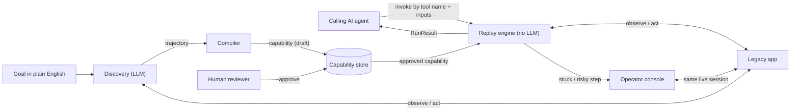

## 2. Components

| Component | File | What it does | Uses |
|---|---|---|---|
| Surface interface | `cua/surface/base.py` | Defines `Observation` and `Control`, and the `Surface` protocol (observe, click, fill, read, screenshot...). Everything above it only sees these types. | nothing |
| Web surface | `cua/surface/web.py`, `perceive.js` | Playwright implementation. Injects a script into every frame that lists controls by role, visible label and table row/column. Also blocks off-allowlist requests and records human clicks. | Playwright |
| Locator | `cua/locator.py` | Finds a target in an observation and checks conditions. Plain functions, no browser. | schema |
| Schema | `cua/schema.py` | The capability format plus AppProfile and TenantBinding. Validates itself on load. | Pydantic |
| Discovery agent | `cua/discover.py` | The LLM loop: observe, ask the model for one tool call, check policy, act, record. Detects when it's stuck. | Anthropic SDK, surface, policy, redactor, control |
| Compiler | `cua/compiler.py` | Turns the trajectory into a capability: locators, templates, checkpoints, leak check. | schema, locator |
| Replay engine | `cua/replay.py` | Runs a capability step by step, applies outcome rules and recoveries, escalates to a human. | surface, locator, policy, redactor, control |
| Result contract | `cua/result.py` | `RunResult` and the error codes returned to the caller. | Pydantic |
| Policy | `cua/policy.py` | Allowlist for URLs and actions, classifies risky actions. | config |
| Redactor | `cua/redact.py` | Masks secrets and PII in logs, model input, screenshots and artifacts. | nothing |
| Evidence recorder | `cua/evidence.py` | Writes the JSONL event log, screenshots and DOM snapshots for a run. | redactor |
| Control / handoff | `cua/control.py` | Lease (who is in control) and intervention requests. | filesystem |
| Operator console | `cua/operator.py` | Web page where a human claims a request, sees and drives the live browser, and hands back. | FastAPI, Playwright over CDP |
| Tenancy | `cua/tenancy.py` | Loads config, applies tenant overrides, resolves secret references, fills templates. | schema |
| CLI | `cua/cli.py` | Entry point for every command. | everything |
| Add-ons | `cua/stability.py`, `cua/learn.py` | Stability check over N replays; turning a human fix into a proposed rule. | replay, schema |
| Mock target | `mockapp/app.py` | Legacy-style core banking app with two tenants and fault injection. | FastAPI |

## 3. Layers

The key boundary is the surface interface. Nothing above it knows it's talking to a browser.

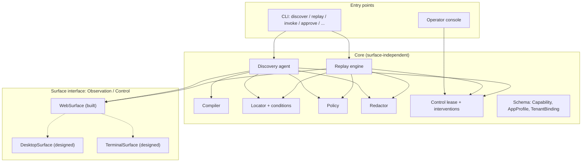

Adding a desktop app means writing a new surface that returns the same `Control` objects (role, name, native id, row/column). The capability format, replay engine and compiler stay the same.

## 4. Main flows

### 4.1 Discovery

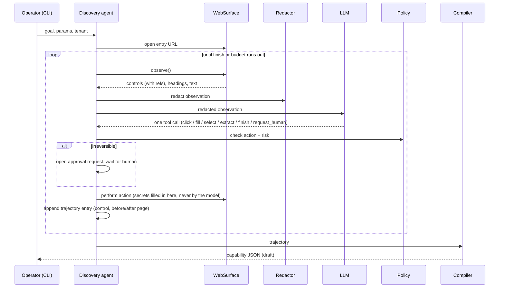

The model only ever sees a redacted text view and refers to controls by short-lived refs like `f3e0`. The trajectory stores the full description of each control (role, label, frame, table row), which is what the compiler turns into durable locators.

### 4.2 Replay

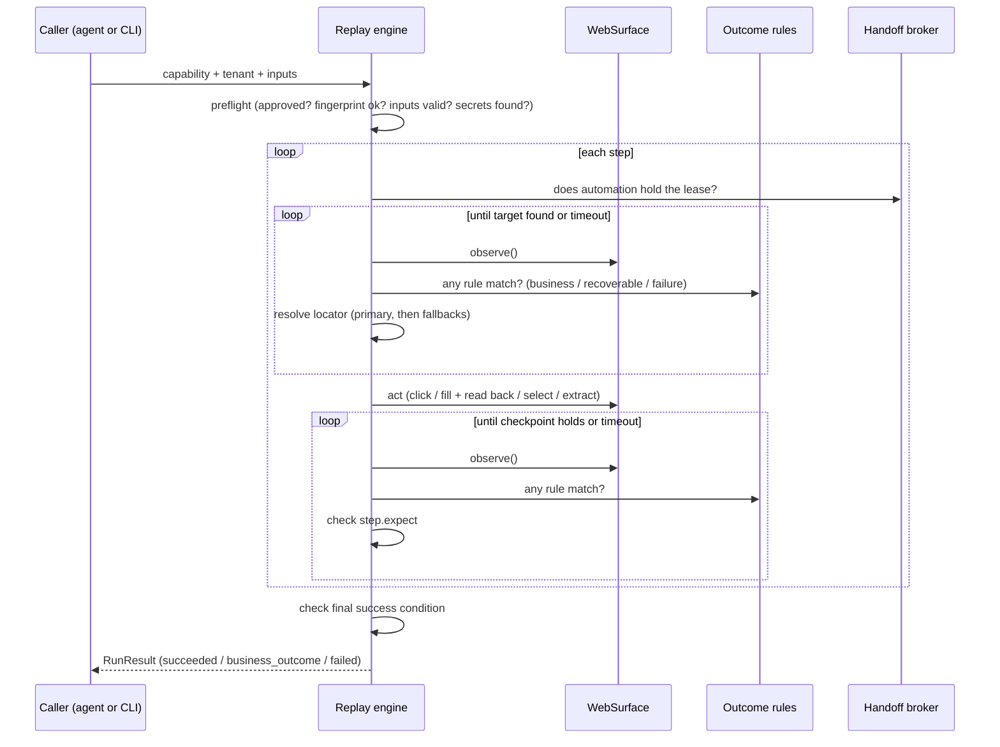

Outcome rules are checked on every poll, before the checkpoint. A recoverable match triggers its recovery (dismiss, restart or wait), a business match ends the run with that outcome, and a failure match ends it with an error and evidence.

### 4.3 Human handoff

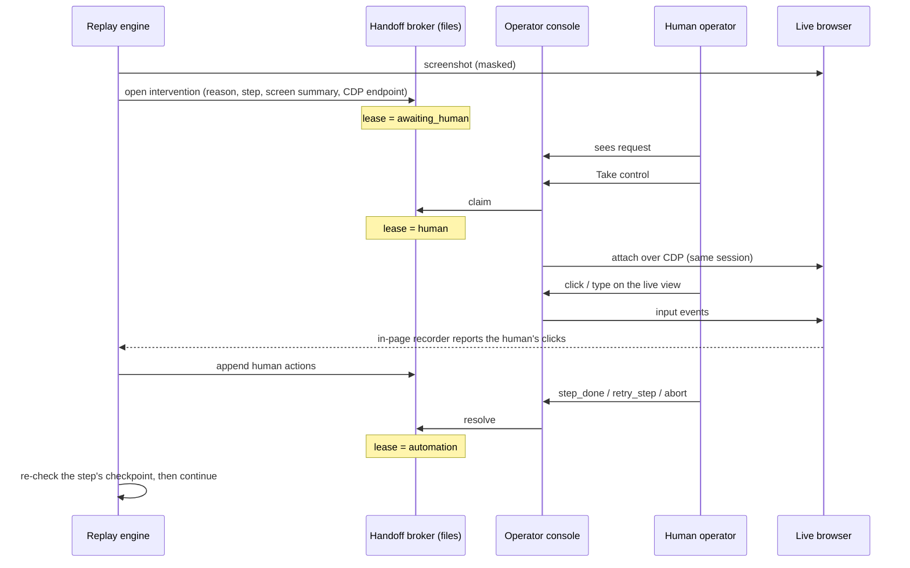

## 5. Data model

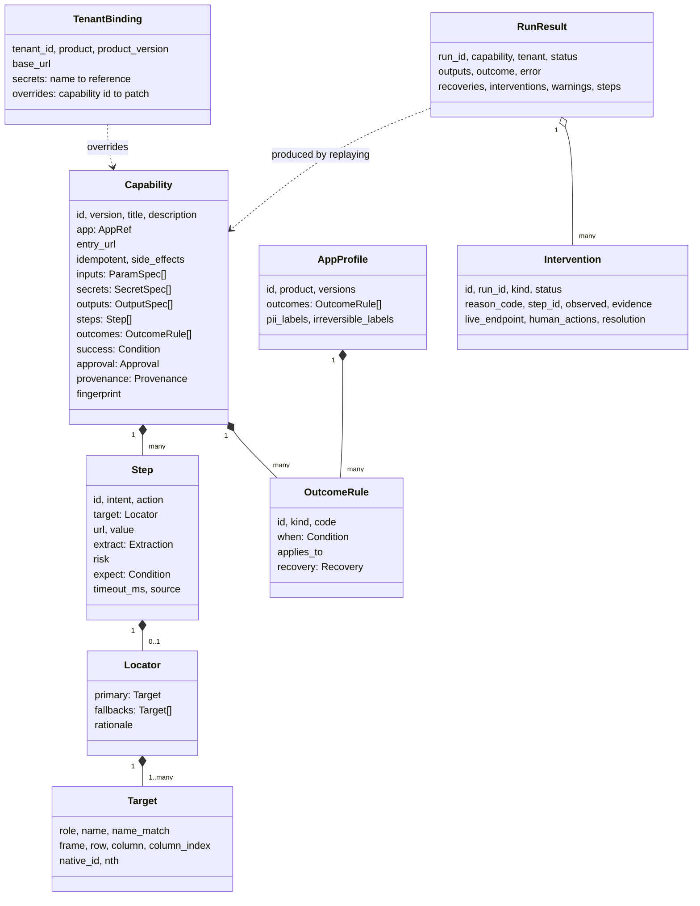

`Condition` is one of `text_visible`, `control_present`, `url_matches`, `all_of`, `any_of`. Templates (`{{inputs.x}}`, `{{secrets.x}}`, `{{tenant.base_url}}`) can appear in URLs, values, target names and row anchors, and are checked against the declared inputs and secrets when the file is loaded.

**What a run uses:** the base capability, patched with the tenant's overrides, plus the vendor profile's rules and PII labels, plus the tenant's secrets and base URL, plus the caller's inputs.

## 6. State machines

### 6.1 Who controls the session (lease)

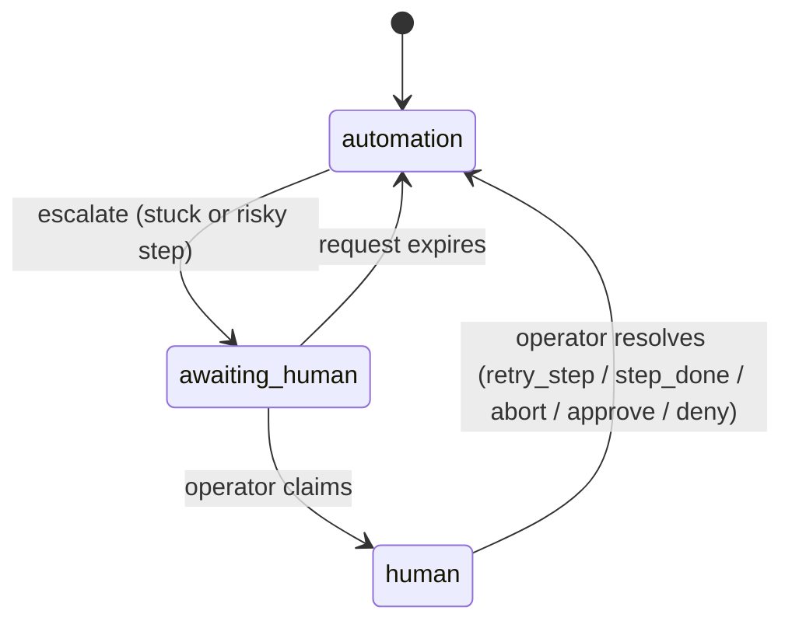

The executor checks the lease before every action. While it's `awaiting_human` or `human`, automation doesn't touch the page. Only the operator who claimed the request can send input or resolve it.

### 6.2 Capability lifecycle

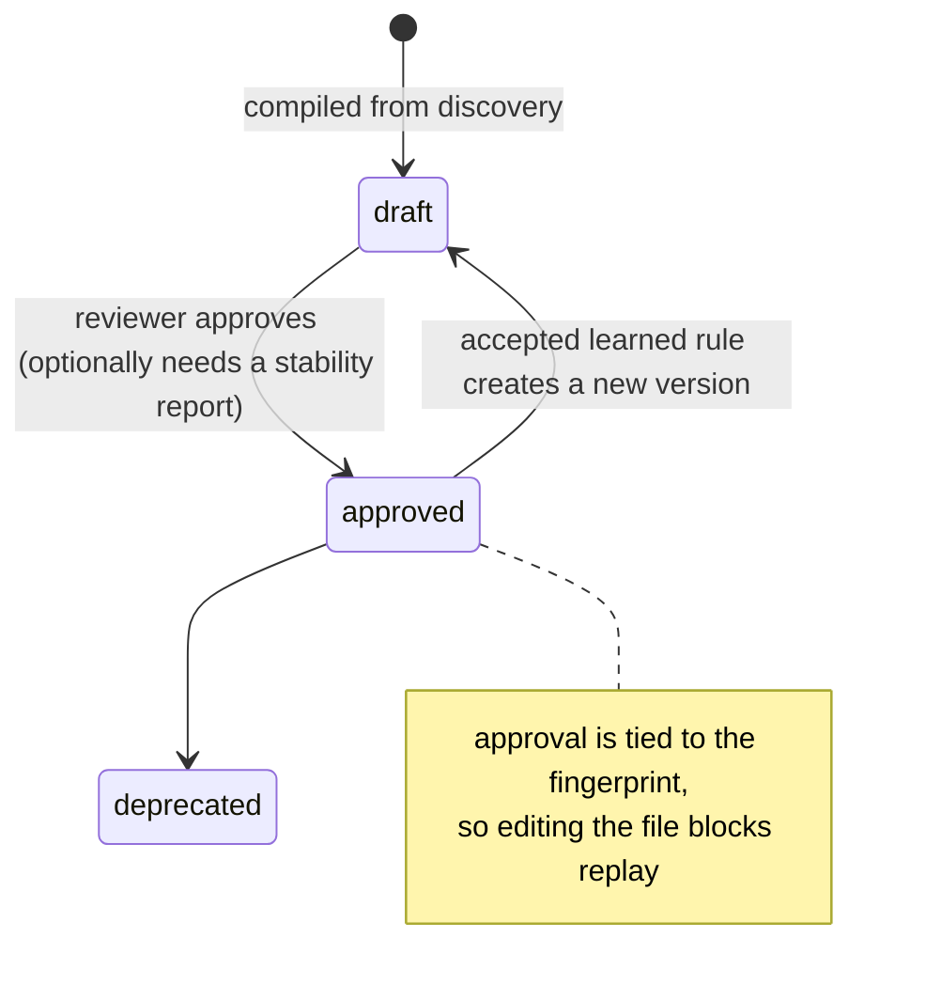

A draft can be replayed for testing with `--allow-draft`, but not if it has irreversible steps.

### 6.3 How a replay ends

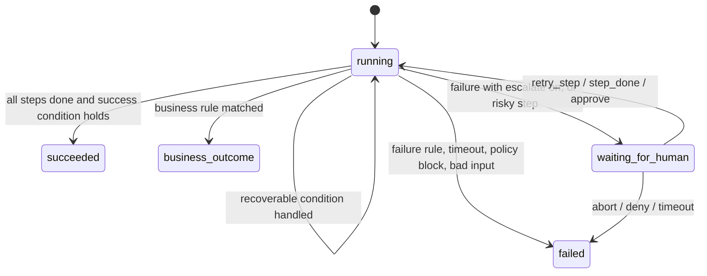

## 7. Storage

Right now everything is files, which is enough for one machine and easy to inspect.

| Data | Location today | Production |
|---|---|---|
| Capabilities | `capabilities/<id>/<version>.json` | Registry table keyed by (id, version), with approval status, fingerprint and tenant overrides |
| Vendor profiles, tenants, policy | `config/**/*.json` | Config service or database, versioned |
| Run logs | `runs/<run_id>/events.jsonl` | Append-only event store or log pipeline |
| Screenshots, DOM snapshots | `runs/<run_id>/screens`, `dom` | Encrypted object storage with retention rules |
| Leases, interventions | `runs/_control/leases`, `interventions` | Database rows plus a work queue for operators |
| Learned-rule proposals | `proposals/*.json` | Review queue |
| Stability reports | `runs/stability/*.json` | Metrics store |
| Secrets | `.env`, referenced as `env:NAME` | Vault, referenced as `vault:path` |

Member data is never stored by this system. It lives in the bank's own app; we only see it on screen, mask it, and return the declared outputs to the caller.

## 8. Trust boundaries

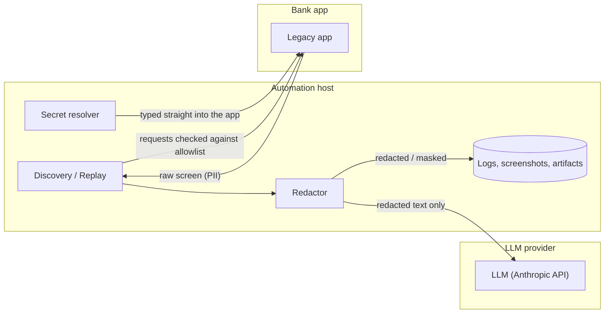

- The model never gets secrets, screenshots or unmasked PII.
- Secrets go from the resolver straight into the app's input fields. They're never in artifacts or logs.
- Every browser request is checked against the allowlist, including requests made while a human is in control.
- Replay has no model, so page text can't steer it.

## 9. Running it in production (design only)

What's built is one process per run on one machine. At the scale in the brief (hundreds of tenants, about 20 apps each), it would look like this:

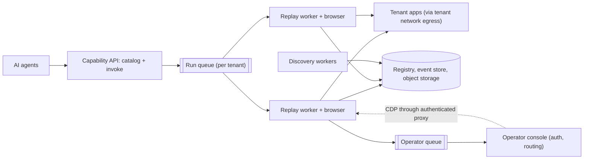

- **Workers.** Each replay runs in its own browser in a stateless worker. Throughput scales with the number of workers.
- **Isolation.** Queues and credentials are per tenant, so one tenant's load or outage doesn't affect others, and a worker only holds the secrets it needs for that run.
- **Handoff.** Interventions go to an operator queue with routing and SLAs. The CDP connection goes through an authenticated proxy instead of an open local port.
- **Drift.** Scheduled stability runs per (capability, tenant) act as canaries. Fallback warnings and checkpoint failures are grouped by tenant and step, so it's clear whether one tenant changed or a vendor release changed everyone.
- **Reuse.** One base capability per vendor product and version range, with small per-tenant override patches. Rules learned on several capabilities can move up into the vendor profile so every tenant gets them.

None of this infrastructure is built, on purpose; the brief asks for the design, not the plumbing. The data models and state machines above stay the same when the storage and transport change.

## 10. Extension points

| To add | Change | Nothing else changes |
|---|---|---|
| A new surface (desktop, green screen) | New class implementing `Surface` that returns `Control` objects | schema, compiler, replay, locator |
| A new tenant on an existing product | New `config/tenants/<id>.json` with base URL, secret references, and overrides if labels differ | capability |
| A new known error or notice screen | Add an `OutcomeRule` to the vendor profile (all capabilities) or to one capability | code |
| A new flow | Run discovery with a new goal, review, approve | code |
| A new risky-action word | Add a pattern to `policy.json` or the profile's `irreversible_labels` | code |
